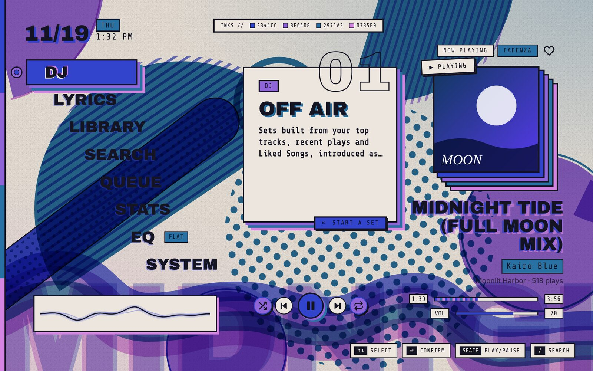
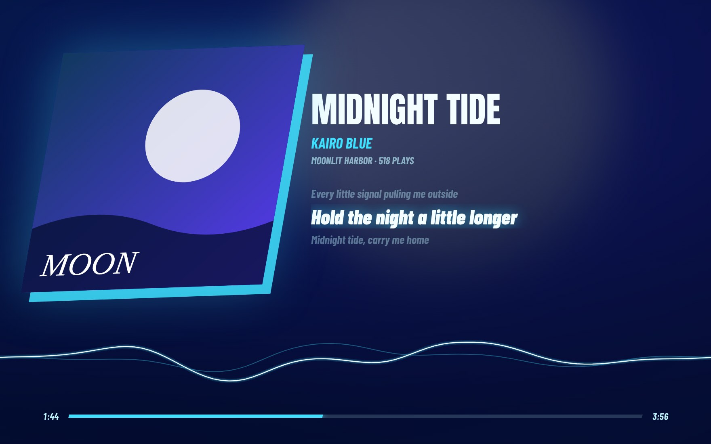
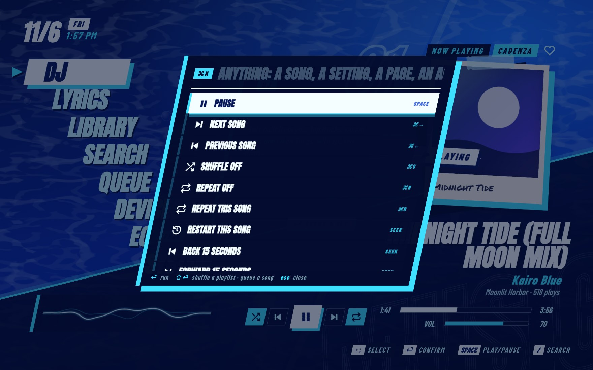
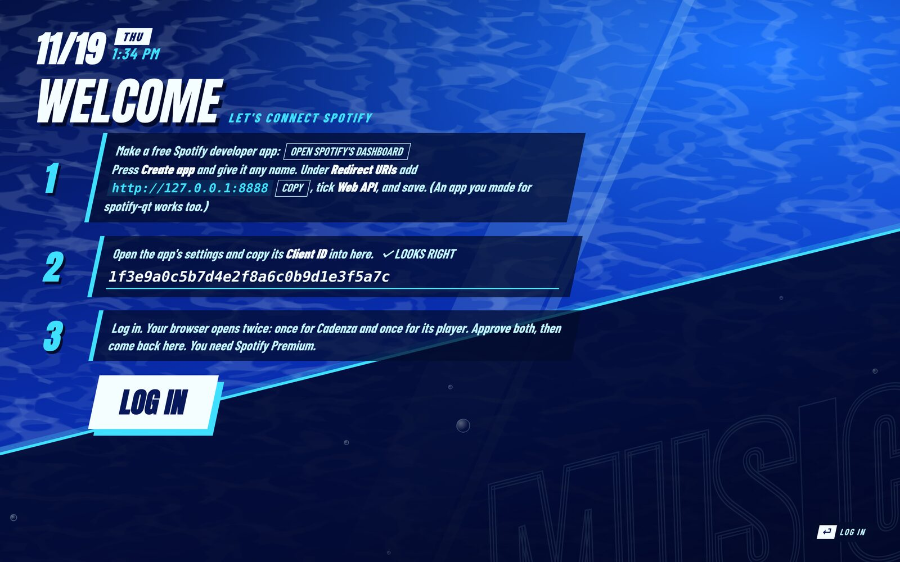
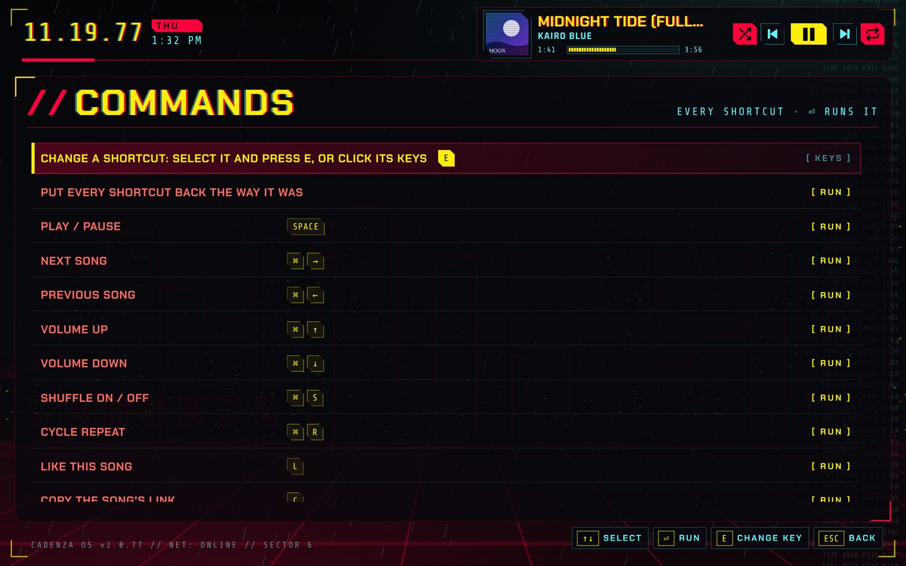
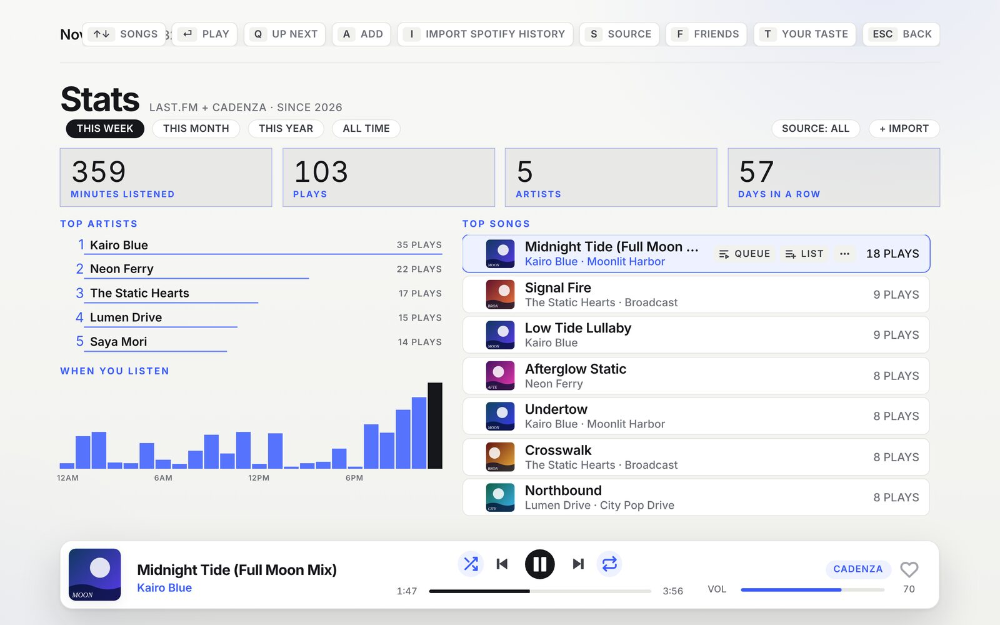
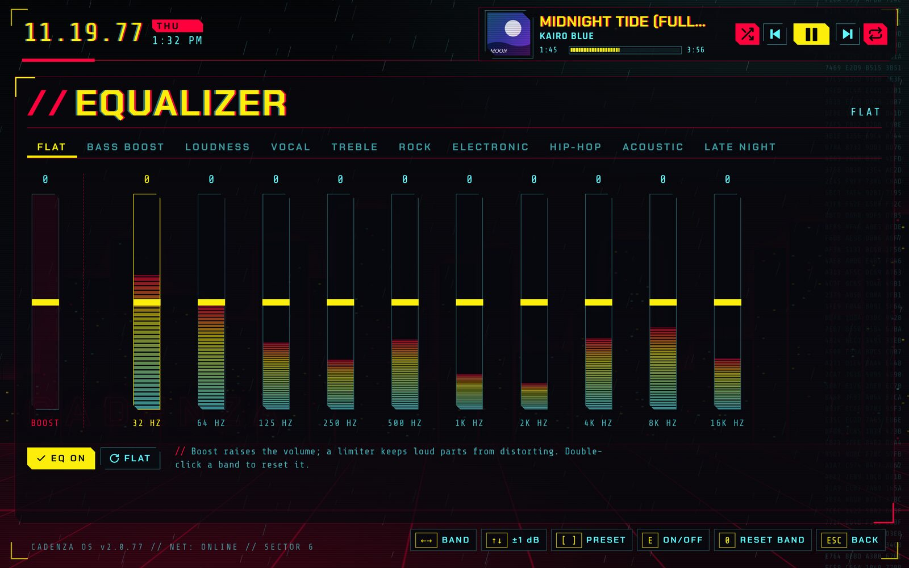
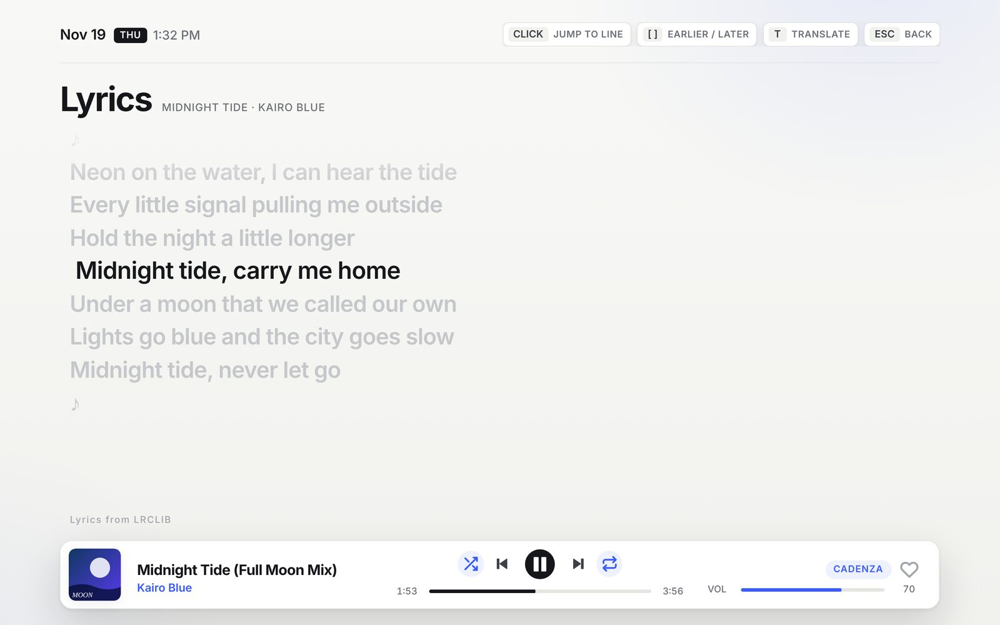
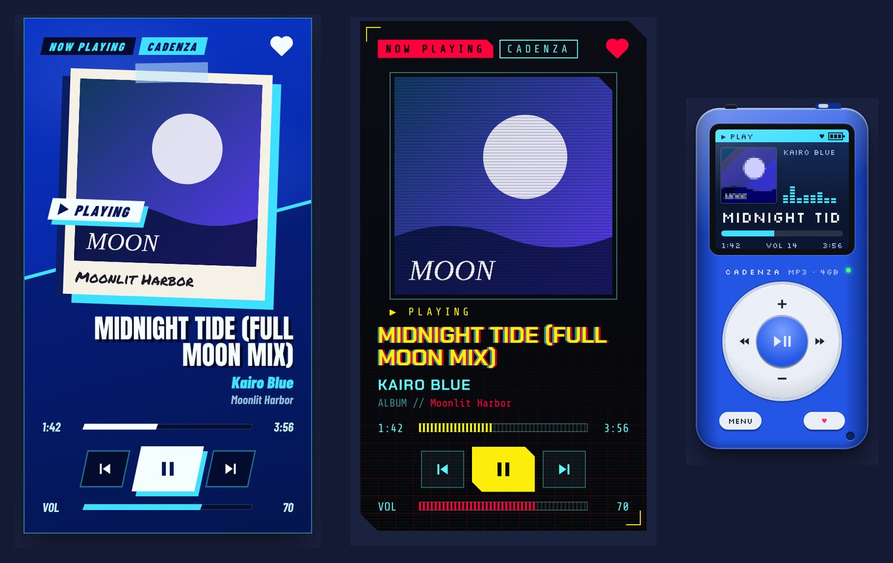
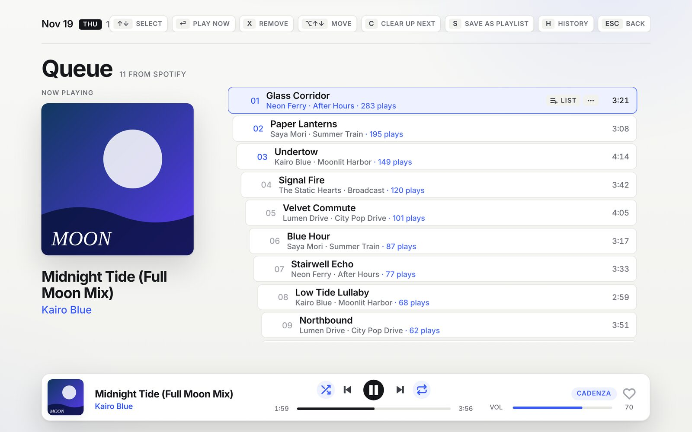

# Cadenza

A keyboard-first Spotify player for Mac, Windows and Linux: game-menu themes, an autoplay that learns
your taste, a DJ, synced lyrics with offline translation, a real equalizer and a full-screen stage mode.

> Cadenza is unofficial. It isn't made, endorsed or supported by Spotify. You need Spotify Premium and
> your own free Spotify developer app (see [Install](#install)).


| HEIST · RED | NEON · CITY |
|---|---|
|  |  |
| **STUDIO · MINIMAL** | **CHROMA · COVER** |
|  |  |
| **Stage mode** | **Command palette (⌘K)** |
|  |  |

<sub>All screenshots come from the built-in demo mode, so the songs and covers are made up.</sub>

## Contents

- [What it does](#what-it-does)
- [Install](#install)
- [Uninstall](#uninstall)
- [Using it](#using-it)
- [Sound](#sound)
- [Autoplay and your taste](#autoplay-and-your-taste)
- [Stats and your Spotify history](#stats-and-your-spotify-history)
- [Lyrics and translation](#lyrics-and-translation)
- [Connections: Last.fm, Discord, Genius](#connections-lastfm-discord-genius)
- [Links for Shortcuts, scripts and launchers](#links-for-shortcuts-scripts-and-launchers)
- [Your data and privacy](#your-data-and-privacy)
- [Updates](#updates)
- [Working on Cadenza](#working-on-cadenza)
- [Troubleshooting](#troubleshooting)
- [Credits](#credits)

## What it does

Cadenza is one app for Mac, Windows and Linux, built with [Tauri](https://tauri.app): the interface is a
web page drawn by the system's own web view, and the native side is written in Rust. It controls Spotify
through the official Web API and plays the sound itself: [librespot](https://github.com/librespot-org/librespot)
is built into the app, and Cadenza plays, skips and queues songs in it directly, through its own sound
engine.

**Listening**

- Autoplay that keeps similar songs coming after anything you play, and learns from what you finish,
  skip, like and save. See [Autoplay and your taste](#autoplay-and-your-taste).
- A DJ that builds sets from what you've had on repeat, old favourites, forgotten Liked Songs and deep
  cuts, and introduces each part on screen. With Last.fm it also brings back songs you used to play
  constantly and what you were playing this week a year ago.
- True shuffle: the playlist is shuffled once when you start it (every order equally likely), and that
  order is followed to the end, even if you quit and reopen Cadenza. Every song plays once, and the Queue
  page shows the whole order. When it runs out, autoplay carries on from your taste (or, with repeat on,
  a fresh shuffle starts).
- One queue, Cadenza's: Up Next, then the shuffle (or list, or DJ set) or autoplay's picks. Move any song
  in it, take any song out, and what plays changes at once. Previous goes back through the songs you just
  heard (the Queue page shows the last three as −1, −2, −3), and Next returns to where you were. A sleep
  timer that fades out.
- A signal path panel (P on the EQ page): which file Spotify is sending, what loudness, volume, EQ,
  crossfade and rate conversion do to it, and whether anything changes the sound at all.
- Cadenza's own sound engine: a ten-band EQ with presets and a boost (with a limiter so loud parts never
  distort), or a parametric EQ (any frequency, gain and width) with headphone corrections from AutoEq and
  Equalizer APO files; a crossfade between songs; and pause, skip and seek that respond at once. Each output
  device keeps its own EQ. See [Sound](#sound).
- Synced lyrics, translated offline into your language with one key.

**Your music**

- A playlist builder: your playlist on one side, suggestions that follow the whole playlist on the
  other, plus search for songs and artists, mood filters, drag to reorder, undo.
- Stats for the week, month, year or all time, from your whole Spotify history, Last.fm and Cadenza
  together, with no play counted twice.
- Play counts from Last.fm on every song, Friends (what your Last.fm friends are playing, taste match,
  blends), and playlist tags (genre · mood · era).
- Playlist tools: remove duplicates, sort, copy, make a playlist collaborative, save the queue as a
  playlist.

**Look and feel**

- Five themes, each with its own layout, animations and synthesised sounds: TIDE · BLUE, HEIST · RED,
  NEON · CITY, STUDIO · MINIMAL and CHROMA · COVER, which takes its colours from the album cover that's
  playing. There's one more hidden somewhere.
- Stage mode: the cover full screen with lyrics and a live visualizer.
- A command palette (⌘K) that reaches every page, playlist, setting, device, theme and button, with
  live Spotify results as you type.
- Every shortcut on one page, and the ones that work everywhere can be changed.
- A floating mini player in your theme's style (or as a little MP3 player), a tray or menu-bar icon,
  media keys and the system's Now Playing, notifications and Discord status.
- Reduce motion, following your system's setting or set by hand.

## Install

**You need:** Spotify Premium (Spotify only allows playback control with Premium), and one of:

- macOS 13 (Ventura) or later (the downloads are for Apple Silicon; on an Intel Mac, build it yourself);
- Windows 10 or 11;
- Linux with a desktop (tested on Ubuntu; other distributions with WebKitGTK 4.1 work too).

### 1. Make a Spotify developer app

It's free and takes about two minutes. Everyone makes their own: since 2026 Spotify limits each developer
app to 5 users, so one shared app can't work. Cadenza's first screen walks you through it, with a button
that opens the dashboard and one that copies the address:

1. At [developer.spotify.com/dashboard](https://developer.spotify.com/dashboard), press **Create app** and
   give it any name.
2. Under **Redirect URIs**, add `http://127.0.0.1:8888`.
3. Tick **Web API** and save.
4. Open the app's settings and copy its **Client ID**.



### 2. Install Cadenza

Downloads are on the [Releases](https://github.com/Chedd4rr/Cadenza/releases) page from the first
release on. Until then, build it yourself (below).

Cadenza isn't signed with a paid certificate from Apple or Microsoft, so your system warns you the first
time you open it. That's expected for free open-source apps; the steps below get past it once.

**Mac**

1. Download `Cadenza-x.y.z-Mac-AppleSilicon.dmg` (Apple Silicon Macs only), open it and drag Cadenza into Applications.
2. Open Cadenza. macOS says it can't check it for malicious software: press **Done**, then go to
   System Settings → Privacy & Security, scroll down and press **Open Anyway** next to Cadenza. After
   that it opens normally.

**Windows**

1. Download `Cadenza-x.y.z-Windows-Setup.exe` and run it. If Windows says it protected your PC, press
   **More info**, then **Run anyway**.
2. It installs for your account only, so it doesn't ask for an administrator. Cadenza is then in the
   Start menu.

**Linux**

- Download `Cadenza-x.y.z-Linux.AppImage`, make it runnable (`chmod +x Cadenza-*.AppImage`) and open
  it.
- On GNOME, the tray icon needs the "AppIndicator" extension (Ubuntu has it already). Cadenza works
  without it too.

**Building it yourself**

You need [Rust](https://rustup.rs) on every system, and:

- **Mac:** Apple's Command Line Tools (`xcode-select --install`).
- **Windows:** the [Visual Studio Build Tools](https://visualstudio.microsoft.com/downloads/) with
  "Desktop development with C++", and [Git for Windows](https://git-scm.com). Run the commands below in
  **Git Bash**. On ARM Windows, also LLVM (`winget install LLVM.LLVM`).
- **Linux (Ubuntu and Debian):**
  `sudo apt install libwebkit2gtk-4.1-dev libgtk-3-dev librsvg2-dev libayatana-appindicator3-dev libasound2-dev libssl-dev libxdo-dev`.
  On Fedora: `webkit2gtk4.1-devel gtk3-devel librsvg2-devel libappindicator-gtk3-devel alsa-lib-devel openssl-devel libxdo-devel`.

Then:

```bash
git clone https://github.com/Chedd4rr/Cadenza.git
cd Cadenza
./build.sh --install
```

On a Mac this builds Cadenza, signs it with a certificate it makes once in your login keychain ("Cadenza
Local Signing", so macOS keeps its permissions across rebuilds), puts it in Applications and opens it.
On Windows and Linux it builds the installers into `desktop/target/release/bundle/`: the setup `.exe`
on Windows, the `.deb` and `.AppImage` on Linux. The first build takes a while because it also builds
librespot into the app (see [The built-in librespot](docs/librespot.md)); later builds are much quicker.

To update a copy you built: `git pull`, then `./build.sh --install` again.

### 3. Sign in

Paste your Client ID and press **Log in**. Your browser opens twice: once to let Cadenza control
Spotify, and once to sign in its player (librespot). Approve both, then come back. Cadenza now shows up
as a speaker called "Cadenza" in every Spotify app.

## Uninstall

First turn off **Open at login** (System → Preferences) if you had it on, and quit Cadenza (its tray or
menu-bar icon → Quit, or ⌘Q / Ctrl+Q). Then remove the app, and, if you want, everything it saved.

**Mac**

1. Drag `Cadenza.app` from Applications to the Trash.
2. To remove your data and settings too, run:
   ```bash
   rm -rf ~/Library/Application\ Support/Cadenza \
          ~/Library/Application\ Support/io.github.chedd4rr.cadenza \
          ~/Library/WebKit/io.github.chedd4rr.cadenza \
          ~/Library/Caches/io.github.chedd4rr.cadenza
   ```
3. If you built Cadenza yourself: `rm -rf ~/Library/Developer/Cadenza` (the build cache), and delete "Cadenza Local Signing" in Keychain Access if you like.
4. If you used test mode: `rm -rf ~/Library/Application\ Support/Cadenza\ Test`.

**Windows**

1. Settings → Apps → Installed apps → Cadenza → **Uninstall**.
2. To remove your data and settings too, delete these folders (paste each into File Explorer's address
   bar):
   - `%APPDATA%\Cadenza` (your sign-ins, settings, history and the rest)
   - `%APPDATA%\io.github.chedd4rr.cadenza` (the window's position)
   - `%LOCALAPPDATA%\io.github.chedd4rr.cadenza` (the web view's cache)

**Linux**

1. If you installed the `.deb`: `sudo apt remove cadenza`. If you used the AppImage: delete the file.
2. To remove your data and settings too:
   ```bash
   rm -rf ~/.local/share/cadenza ~/.local/share/io.github.chedd4rr.cadenza \
          ~/.config/io.github.chedd4rr.cadenza ~/.cache/io.github.chedd4rr.cadenza
   rm -f ~/.config/autostart/Cadenza.desktop
   ```
3. If you built Cadenza yourself: `rm -rf ~/.cache/cadenza-build` (librespot's source). Test mode
   uses `~/.local/share/cadenza-test`.

**Spotify:** to take away Cadenza's access, remove your app at
[spotify.com/account/apps](https://www.spotify.com/account/apps/), and delete the developer app on the
[dashboard](https://developer.spotify.com/dashboard) if you no longer need it.

## Using it

Everything works from the keyboard; the mouse and trackpad work too. The bottom of each page shows its
keys, and ⌘/ lists every one. On Windows and Linux, use Ctrl where this says ⌘ and Alt for ⌥; Cadenza's
own screens show them that way.

| Key | Does |
|---|---|
| ↑ ↓ ← → · Return · Esc | Move · choose or play · back |
| Space | Play / pause |
| ⌘→ / ⌘← · ⌘↑ / ⌘↓ | Next / previous song · volume |
| ⌘S / ⌘R | Shuffle / repeat |
| ⌘K | Command palette: anything, by typing a few letters |
| ⌘F or / | Search |
| F or ⇧⌘F | Stage mode |
| ⌘T · ⌘, · ⌘/ | Switch theme · settings · every shortcut |
| ⌥⌘P | Show or hide Cadenza from any app |
| L / C / M | Like / copy link / song menu |
| Q / A | Add to Up Next / add to a playlist |
| ⇧⌘M | Floating mini player |
| ⇧⌘D | Copy diagnostics, for a bug report |

**Changing shortcuts.** On the keyboard page (⌘/), select a shortcut and press **E**, or click its keys,
then press the new ones. Esc cancels, ⌫ removes it, and the row at the top puts them all back. You can
change the shortcuts that work everywhere (playback, volume, like, the palette, search, stage mode, the
show/hide shortcut and the rest); keys inside a page, like P to play a playlist, stay as they are. A key
another shortcut uses moves over to the new one, and keys you need for typing (⌘C, ⌘V, Esc…) can't be
taken. On a Mac, the menu bar follows your changes.



| Page | What's there |
|---|---|
| Home | DJ, Lyrics, Library, Search, Queue, Stats, EQ and System, with Now Playing and the playback controls |
| Library | Liked Songs and your playlists, with genre · mood · era tags. N starts a new playlist in the builder |
| Build | The playlist builder. Tab switches sides; ⏎ adds, P previews, drag or ⌥↑↓ moves, X removes, ← → picks a mood, R finds more ideas, D spreads artists out, U undoes, S saves |
| Playlist / Album / Artist | Play, queue, add, remove, reorder, edit details and cover, follow, share |
| Search | Songs, albums, artists and playlists (Tab switches); Search → Lyrics finds a song from a line you remember |
| Queue / History | Up Next, then what's lined up after it: the shuffle, the list, the DJ set or autoplay's picks (with why each autoplay song is there). ⌥↑↓ moves any song, X takes it out. History is what you played recently |
| Stats | Top artists and songs, plays and when you listen. I imports your Spotify history, S switches source |
| Your taste | What autoplay has learned about you, and the controls to correct it (T in Stats) |
| Friends | Your Last.fm friends (F in Stats) |
| EQ | Ten bands, presets, boost, and live meters; G for the parametric EQ, H for headphone profiles. P shows the signal path: the file Spotify sent, and everything between it and your speakers |
| Lyrics | Synced lyrics; T translates them |
| System | Theme, account and settings; Devices, Sound & EQ, Connections, Preferences and Engine settings |

| Library | Stats |
|---|---|
|  |  |
| **EQ** | **Lyrics** |
|  |  |

**The mini player** floats above your other windows, in your theme's style or as a little MP3 player
(System → Preferences). Open it from the tray or menu-bar icon, with ⇧⌘M, or with `cadenza://mini`; drag
it anywhere and it remembers where. Closing Cadenza's window keeps the music going while the tray or
menu-bar icon is there; Quit ends it.



**Reduce motion** (System → Preferences) follows your system's setting, or can be turned on or off
here. While it's on, slides, fades and moving backgrounds stand still, in the mini player too; the
visualizer and progress bars still show the music.

## Text that doesn't fit

When a name or line is too long for its space, the one you're on (or pointing at) slides along slowly to show the rest, waits, and slides back. Text that fits never moves, and the mouse also gets the whole text as a tooltip. With Reduce motion on, nothing slides: the full text appears in a small box next to the item instead. Long notices wrap onto up to three lines instead of being cut off.

## Sound

Spotify only gives apps like Cadenza 320 kbps Ogg Vorbis (never lossless), so what Cadenza can do is keep
that file from being changed on its way to you, and give you the tools to shape it.

- **Parametric EQ** (G on the EQ page): up to ten filters, each a peak, a low shelf or a high shelf at any
  frequency, gain and width. ← → picks a filter, ↑↓ its gain, [ ] its frequency (⇧ for bigger steps),
  Q its width (⇧Q wider), T its type. G goes back to the ten-band EQ; each keeps its own settings.
- **Headphone profiles** (H): search [AutoEq](https://github.com/jaakkopasanen/AutoEq) by name and pick
  your model; its measured correction loads as a parametric EQ, on the device you're using. I imports an
  Equalizer APO file (AutoEq's "ParametricEQ.txt", or your own).
- **Even out by** (System → Sound & EQ): with even loudness on, *auto* levels whole albums when one plays
  in order (so its quiet and loud songs stay as mastered) and single songs otherwise; or always each song,
  or always the whole album.
- **Match output rate** (Mac): sets your Mac's output to 44.1 kHz while Cadenza plays, so macOS doesn't
  convert Spotify's sound to 48 kHz. It's put back when Cadenza rests or quits. (Other apps' sound plays at
  that rate too meanwhile.)
- **Exclusive mode** (Mac): Cadenza has the output to itself, so nothing is mixed in. Other apps go quiet
  on that output while Cadenza plays, and get it back when Cadenza rests or quits.
- **Channels**: balance, mono, swapping left and right, flipping polarity, and a test tone for each
  speaker.
- **Buffer**: per output device, automatic or 1024 to 8192 frames. Smaller reacts faster, bigger is steadier.

The signal path panel (P on the EQ page) shows all of these as they apply to the song playing.

## Autoplay and your taste

Play a song from Search (or choose "Song radio" from a song's menu) and similar songs keep coming
after it. When an album or playlist ends, it carries on the same way. Turn it off in System →
Preferences.

Similar songs come from Last.fm's listening data, or from Spotify's search without Last.fm. A song you
pick yourself sets the direction; songs from before it don't steer what comes next. Autoplay never
lines up a song you've heard in the last day (in any version), never the same song twice in a session,
and spaces artists out: the artist you started from gets at most one more song early on, then it moves
on to similar artists.

Each pick is ranked by a **taste profile** that learns from:

- what you finish and skip, and how fast (skipping a song autoplay chose counts the most);
- liking a song, adding it to a playlist, playing it again within a day, choosing it yourself;
- "More like this", "Less like this", and marking artists you love or hate (in any song's menu);
- your imported Spotify history and Last.fm scrobbles, as a head start (they count a quarter as much as
  what you do now).

It scores artists, songs and styles by the share you keep compared with your usual, how many different
songs (or, for styles, artists) you come back to, how long you've stuck with them, how many of your
playlists they're in, and how much you've played them lately. Old listening fades, and songs you
binged and dropped count for less. It also learns which of these matter most to you from which of its
picks you keep, and by default every sixth song is a new artist so it keeps finding things. You can
turn that up or down with the **familiar ↔ new dial**, and keep separate tastes for Focus, Workout and
the like (see [Controlling autoplay](#controlling-autoplay)).

The **Your taste** page (T in Stats, or ⌘K) shows what it has learned: artists and styles you love,
artists you skip, what you play at different times of day, and how much each factor counts. Each bar
shows the part built up over time and the part from lately. Press X to take something out, + or − to
mark an artist you love or hate (hated artists are never autoplayed), and Tab for the controls.

The full details of how it works are in [docs/taste.md](docs/taste.md).

### Controlling autoplay

These are all together in **System → Autoplay** (the on/off switch, the dial, the mode, the never-play
lists and a link to the Your taste page), and also on the Your taste page, where Tab goes to the controls:

- **Familiar ↔ new dial (D):** five steps, from *familiar only* (no new artists on purpose) through
  *balanced* (a new artist about one song in six, how it has always worked) to *all new* (every other
  song). It also nudges how high new artists score.
- **Never-play rules:** "Never autoplay [artist]" and "Never autoplay this song" are in any song's menu
  (M) and in ⌘K. Never-played songs match any version of the song. Both lists show at the bottom of the
  controls, where ⏎ or X lets one back in. Autoplay won't line them up; they still play if you pick
  them yourself.
- **Modes (O):** Focus, Workout, Chill, Party, Sleep, Commute, or a name of your own. A mode starts as a
  copy of your taste now and then learns only from what you play while it's on, so a workout playlist
  doesn't leak into your evening. Each mode has its own dial. Never-play rules, and what Cadenza learns
  from your imported history, belong to your main taste and apply everywhere. Switch from the page or ⌘K.



## Stats and your Spotify history

Stats can draw on three sources at once, each play counted once: your whole Spotify history (imported),
then Last.fm scrobbles after it, then anything Cadenza played that Last.fm doesn't have. Press S to
switch to Last.fm's own charts or Cadenza's own log.

To import your history:

1. On [spotify.com/account/privacy](https://www.spotify.com/account/privacy/), tick **Extended streaming
   history** and request it. Spotify emails you a download, usually within a few days (up to 30).
2. In Cadenza, open Stats and press **I**. Pick the .zip, the folder inside it, or the
   `Streaming_History_Audio_….json` files. The shorter "Account data" download works too.

Importing the same files again, or a newer download that overlaps, only adds what's new. A play counts
in Stats from 30 seconds, like on Spotify; shorter plays and how each one ended are kept for the taste
profile. Only the time, length, song, artist, album and link are kept; IP addresses, countries and
devices in Spotify's files are never saved. ⌘K → "Remove imported Spotify history" deletes it.

More detail in [docs/stats.md](docs/stats.md).

## Lyrics and translation

Synced lyrics come from [LRCLIB](https://lrclib.net), timed to what you actually hear. Click a line to
jump there, and nudge the timing with [ and ].

Press **T** on the Lyrics page to translate them into your computer's language. Cadenza works out the
language with Google's CLD3 and translates with Firefox's offline translator; both run inside Cadenza
and the lyrics never leave your computer. The first time you translate a language, its model downloads
from Mozilla (about 15 to 60 MB, checked against Mozilla's published hash); after that it works offline.
System → Preferences → Translation languages shows the space they take and deletes them. Very short
lyrics can be mistaken for a similar language.

## Connections: Last.fm, Discord, Genius

All of these are optional and go in System → Connections.

- **Last.fm** powers play counts, Friends, the DJ's deeper picks, styles in your taste profile and
  better autoplay. It needs your own free API key: go to
  [last.fm/api/account/create](https://www.last.fm/api/account/create), fill in any name and description
  (the callback can stay empty), and paste the **API key** into System → Connections (the shared secret
  isn't needed). Then type your Last.fm username. Cadenza doesn't scrobble itself: link Spotify
  to Last.fm instead (Last.fm settings → Applications → Spotify scrobbling) and Spotify scrobbles
  everything you play, Cadenza included.
- **Discord status:** turn it on, with the Discord app running on the same computer. Your profile then
  shows "Listening to Cadenza" with the song. (Discord's "Share your detected activities" setting has to
  be on; it is unless you turned it off.)
- **Genius** (finding a song from a line of its lyrics): create an API client at
  [genius.com/api-clients](https://genius.com/api-clients), generate an access token and paste it in.

Cadenza has its own Discord application built in, so that needs no setting up (your own goes in System →
Engine settings). Last.fm has no built-in key: a key shared by every copy gets suspended by Last.fm sooner
or later, and that turns Last.fm off for everyone at once.

## Links for Shortcuts, scripts and launchers

Cadenza answers `cadenza://` links, so the Shortcuts app, Raycast, Alfred, a script or a terminal can
control it: `open "cadenza://next"` on a Mac, `start cadenza://next` on Windows, `xdg-open cadenza://next`
on Linux.

| Link | Does |
|---|---|
| `cadenza://toggle` · `next` · `previous` | Play/pause, skip, go back |
| `cadenza://play?q=midnight%20tide` | Find a song and play it, with autoplay after it |
| `cadenza://playlist?name=Gym&shuffle=1` | Play one of your playlists |
| `cadenza://radio` · `dj` | Song radio from what's playing · start the DJ |
| `cadenza://like` · `upnext` | Like the song · add it to Up Next |
| `cadenza://volume?level=40` (or `up` / `down`) | Volume |
| `cadenza://search?q=…` · `go?page=stats` · `friends` | Open Search, a page, or Friends |
| `cadenza://sleep?minutes=30` (or `end`, `off`) | Sleep timer |
| `cadenza://mini` · `show` · `hide` | Floating mini player · show or hide Cadenza |

Links can only control playback and open pages; they can't change settings or delete anything.

## Your data and privacy

Everything stays on your computer, in a folder only your account can open:

| System | Folder |
|---|---|
| Mac | `~/Library/Application Support/Cadenza/` |
| Windows | `%APPDATA%\Cadenza\` |
| Linux | `~/.local/share/cadenza/` |

Cadenza talks to Spotify, and to Last.fm, Discord, Genius, LRCLIB and Mozilla only for the features that
use them. What each one gets: Last.fm your username and the songs and artists it looks up; LRCLIB and
Genius the song (or lyric line) whose lyrics you open or search; Mozilla nothing about you (it only
downloads translation models, and translating happens on your computer); Discord, only when you turn its
status on, what's playing, through the Discord app on your computer.

The page that draws the interface can only reach Cadenza's own commands, under a strict content policy
(no scripts from anywhere else, nothing run from text), and never sees your passwords, tokens or keys.
Your Spotify sign-in is only ever sent to Spotify's own servers.

| File | Holds |
|---|---|
| `settings.json` | Your settings |
| `spotify-token` | Your Spotify login |
| `secrets.json` | Your Genius token (and a Last.fm key and secret, if you set your own); never passed to the page |
| `librespot/` | The audio engine's login, and the songs it has downloaded (up to 1 GB; the least recently played go first) |
| `history.jsonl` | What Cadenza has played |
| `spotify-history.json` | Your imported Spotify history (time, length, song, how it ended) |
| `lastfm-plays.json` | Your Last.fm scrobbles since that history ends, kept so they're only fetched once |
| `taste.json` | Your taste profile |
| `store.json` | Small things: Up Next, playlist tags, the builder draft, remembered matches |
| `translation-models/` | Downloaded translation languages |
| `spotify-requests.log` | Spotify's recent answers after it asked Cadenza to wait (without what you searched for) |

## Updates

Cadenza checks GitHub for a new version when it opens (at most every 6 hours; System → Preferences → Check at
launch), and installs it when you say so: System → Updates shows what's new and the Update button restarts
Cadenza on the new version. Every update is signed with the project's key, and Cadenza refuses anything that
isn't, so changing the "GitHub repository" setting can't get it to run someone else's code. Updating needs the
repository to be public. If you built Cadenza yourself, update with `git pull` and `./build.sh --install`
instead (a build you make has no update key). How releases are made is in [docs/releasing.md](docs/releasing.md).

## Working on Cadenza

The interface is plain HTML, CSS and JavaScript in `Resources/web/`. Open `Resources/web/index.html` in a
browser for a demo with sample data; add `?theme=heist` (or `neon`, `min`, `chroma`) to preview a theme.
The mini player is `Resources/web/mini/mini.html`. Each theme is a folder in `Resources/web/themes/` with
a stylesheet, a script for its background and animations, and its own synthesised sounds; to make one,
see [`Resources/web/themes/README.md`](Resources/web/themes/README.md).

The native side is in `desktop/` (Rust, with Tauri): the bridge to the page, Spotify sign-in, the sound
engine, librespot, the tray, the mini player and the rest. Its files, test mode (running a second copy
beside your normal one to compare them) and its log are explained in
[desktop/README.md](desktop/README.md).

```bash
cd desktop
./build.sh --run    # build and open it, for trying changes
./build.sh --test   # the same, in test mode
cargo test          # the tests
```

Start it with `CADENZA_LOG=1` set to see the engine log, every call between the page and the native
side, every Spotify request and a sound report every few seconds.

GitHub can build Cadenza for any of the three systems: Actions → Desktop app → Run workflow, then pick
the system (it runs the tests too). How librespot is built in and patched is in
[docs/librespot.md](docs/librespot.md); making a release, with updates, is in
[docs/releasing.md](docs/releasing.md); and [docs/windows-check.md](docs/windows-check.md) is the checklist for
trying it on a real Windows PC.

## Troubleshooting

**System → Engine settings → Copy diagnostics** (or ⇧⌘D) copies the engine log, recent playback events
and your settings to paste into a bug report. It leaves out passwords and keys, your Spotify username,
what you searched for, your home folder, and your name wherever it appears (in device names like "Alex's
AirPods").

- **The first time it opens, my system won't let it:** see the warnings under
  [Install](#2-install-cadenza) (Open Anyway on a Mac, Run anyway on Windows).
- **"No active device":** Cadenza restarts the audio engine by itself when Spotify stops listing it
  (usually after sleep or a network change). If it still doesn't appear, check System → Engine settings.
- **"Spotify is refusing songs for a moment"** (and the log shows `error audio key 0 2`): Spotify refused
  to unlock a song (a [known librespot issue](https://github.com/librespot-org/librespot/issues/1649)).
  Skipping a lot quickly is the usual cause: Spotify stops handing out keys when asked too often. Cadenza
  waits a moment and moves on by itself (longer each time it happens again soon), and Next pressed while
  it waits is done in one jump when the wait ends; Play goes on at once. Fast skips are always gathered
  into one jump, so this should be rare. If nearly every song is refused, Spotify is refusing your
  account for now; skipping less for a while helps.
- **Songs I played in Cadenza don't show in Spotify's recents or Wrapped:** the built-in engine plays
  the music but doesn't send Spotify the report that says a song was played, so Spotify doesn't count
  it. Cadenza's own History and Stats (and the Spotify history you import) do include it, and Last.fm
  scrobbling through Spotify's link still works.
- **Login fails:** check the Client ID, and that `http://127.0.0.1:8888` is a Redirect URI of your app.
- **"Spotify says wait":** Spotify limits how often an app can ask for things. Cadenza backs off by
  itself; System → Engine settings → Spotify activity shows what it has been asking for.
- **A playlist's songs don't load:** Spotify only lets apps read playlists you own or collaborate on.
  You can still play the ones you follow (P).
- **No tray icon on Linux (GNOME):** install the "AppIndicator and KStatusNotifierItem Support"
  extension. Everything else works without it.
- **Crackly sound or choppy animations in a virtual machine:** the virtual machine's sound and graphics
  are the cause. Install its guest tools and turn on 3D acceleration; Cadenza's output also gives itself
  a bigger buffer when it notices the computer can't keep up.

## Credits

- [Tauri](https://tauri.app) (MIT / Apache 2.0) runs the app on all three systems.
- [librespot](https://github.com/librespot-org/librespot) (MIT) plays the audio, built into the app. Its
  license ships with the app, in its `licenses` folder.
- Lyrics from [LRCLIB](https://lrclib.net); finding songs by lyrics with the
  [Genius API](https://docs.genius.com).
- Translation with [bergamot-translator](https://github.com/browsermt/bergamot-translator) (MPL 2.0) and
  Mozilla's models, and language detection with [CLD3](https://github.com/google/cld3) (Apache 2.0)
  through [cld3-asm](https://github.com/kwonoj/cld3-asm) (MIT). Both are in `Resources/web/vendor` with
  their notices.
- Fonts: Anton, Barlow Condensed, Archivo Black, Abril Fatface, Bebas Neue, Chakra Petch, Rajdhani,
  Share Tech Mono, Inter, Unbounded, Space Grotesk, JetBrains Mono and Silkscreen (SIL Open Font
  License), and Permanent Marker (Apache 2.0). The licence files sit next to the fonts.

Found a security problem? See [SECURITY.md](SECURITY.md). Spotify is a trademark of Spotify AB; this
project isn't affiliated with Spotify.

## License

[MIT](LICENSE) © 2026 Chedd4rr
