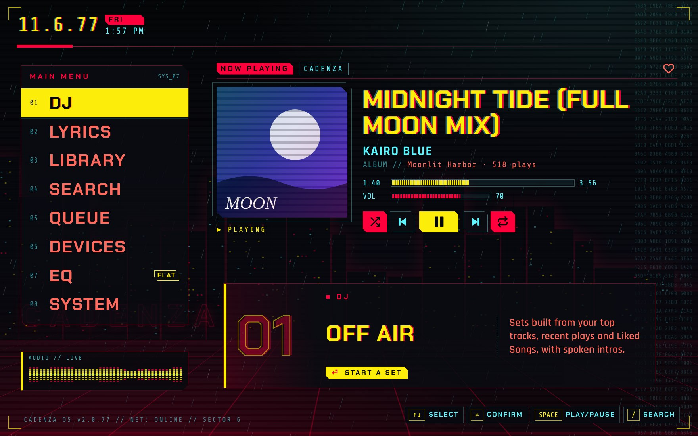
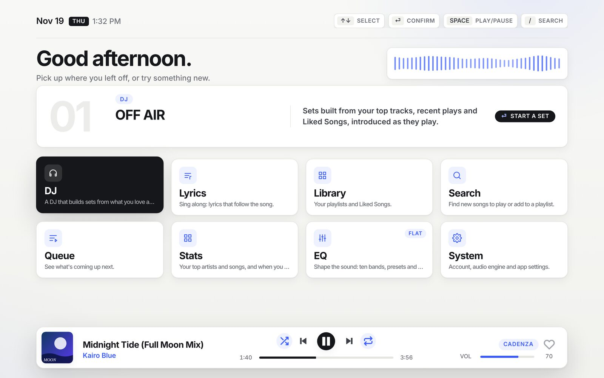
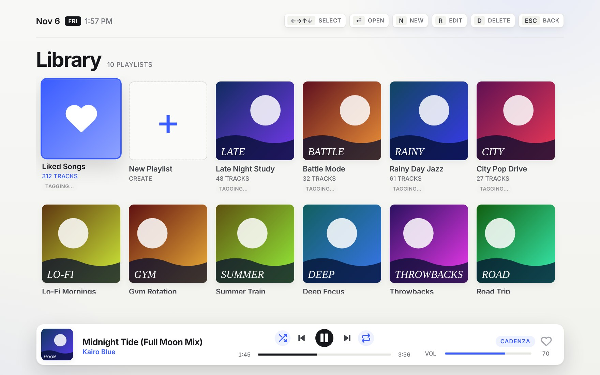

# Cadenza

A keyboard-first Spotify player for macOS: game-menu themes, an autoplay that learns your taste, a DJ,
synced lyrics with offline translation, a real equalizer and a full-screen stage mode.

> Cadenza is unofficial. It isn't made, endorsed or supported by Spotify. You need Spotify Premium and
> your own free Spotify developer app (see [Setup](#setup)).


| HEIST · RED | NEON · CITY |
|---|---|
|  |  |
| STUDIO · MINIMAL | Studio library |
|  |  |
| Stage mode | Command palette (⌘K) |
|  |  |

<sub>The screenshots come from the built-in demo mode, so the songs and covers are made up.</sub>

## Contents

- [What it does](#what-it-does)
- [Setup](#setup)
- [Using it](#using-it)
- [Autoplay and your taste](#autoplay-and-your-taste)
- [Stats and your Spotify history](#stats-and-your-spotify-history)
- [Lyrics and translation](#lyrics-and-translation)
- [Connections: Last.fm, Discord, Genius](#connections-lastfm-discord-genius)
- [Links for Shortcuts, Siri and launchers](#links-for-shortcuts-siri-and-launchers)
- [Your data](#your-data)
- [Updates and releases](#updates-and-releases)
- [Working on Cadenza](#working-on-cadenza)
- [Troubleshooting](#troubleshooting)
- [Credits](#credits)

## What it does

Cadenza is a small native app in Swift that draws its interface with the Mac's built-in WebKit. It
controls Spotify through the official Web API and plays the sound itself, through a copy of
[librespot](https://github.com/librespot-org/librespot) that ships inside the app.

**Listening**

- Autoplay that keeps similar songs coming after anything you play, and learns from what you finish,
  skip, like and save. See [Autoplay and your taste](#autoplay-and-your-taste).
- A DJ that builds sets from what you've had on repeat, old favourites, forgotten Liked Songs and deep
  cuts, and introduces each part on screen. With Last.fm it also brings back songs you used to play
  constantly and what you were playing this week a year ago.
- True shuffle: every order equally likely, every song once before any repeats.
- Up Next, Cadenza's own queue you can reorder, a crossfade like Spotify's, a sleep timer, and a
  ten-band EQ with presets and a boost. Each output device keeps its own EQ.
- Synced lyrics, translated offline into your Mac's language with one key.

**Your music**

- A playlist builder: your playlist on one side, suggestions that follow the whole playlist on the
  other, plus search for songs and artists, mood filters, drag to reorder, undo.
- Stats for the week, month, year or all time, from your whole Spotify history, Last.fm and Cadenza
  together, with no play counted twice.
- Play counts from Last.fm on every song, Friends (what your Last.fm friends are playing, taste match,
  blends), and playlist tags (genre · mood · era).
- Playlist tools: remove duplicates, sort, copy, save the queue as a playlist.

**Look and feel**

- Five themes, each with its own layout, animations and synthesised sounds: TIDE · BLUE, HEIST · RED,
  NEON · CITY, STUDIO · MINIMAL and CHROMA · COVER, which takes its colours from the album cover that's
  playing. There's one more hidden somewhere.
- Stage mode: the cover full screen with lyrics and a live visualizer.
- A command palette (⌘K) that reaches every page, playlist, setting, device, theme and button, with
  live Spotify results as you type.
- A menu-bar player in your theme's style (or as a little MP3 player), a floating mini player, media
  keys, Control Center, notifications and Discord status.

## Setup

**You need:** macOS 13 (Ventura) or later, and Spotify Premium (Spotify only allows playback control
with Premium). To build it yourself you also need Apple's Command Line Tools (`xcode-select --install`)
and Rust (`brew install rust`) for the audio engine.

1. **Make a Spotify developer app.** It's free. At
   [developer.spotify.com/dashboard](https://developer.spotify.com/dashboard), create an app, add
   `http://127.0.0.1:8888` under Redirect URIs, tick Web API, and copy its Client ID. Everyone uses
   their own app, so this project has no shared key.
2. **Get Cadenza.** Either:
   - **Download** a copy from [Releases](https://github.com/Chedd4rr/Cadenza/releases), unzip it and
     drag it into Applications. It isn't notarized by Apple, so the first time, right-click it and
     choose Open, then Open again (or run `xattr -dr com.apple.quarantine /Applications/Cadenza.app`).
   - **Or build it:**
     ```bash
     git clone https://github.com/Chedd4rr/Cadenza.git
     cd Cadenza
     ./build.sh --install
     ```
     This builds the app, puts it in /Applications and opens it. The first build also builds the audio
     engine, which takes a few minutes (see [The built-in librespot](docs/librespot.md)).
3. **Log in.** Paste your Client ID, press Log in and approve in the browser. The audio engine asks you
   to sign in once more in the browser. (If spotify-qt is signed in on your Mac, Cadenza offers to
   reuse its login.)
4. **Allow media keys.** macOS asks for Accessibility permission: turn Cadenza on in System Settings →
   Privacy & Security → Accessibility.

`build.sh` signs the app with a certificate it makes once in your login keychain ("Cadenza Local
Signing"), so macOS keeps that permission across rebuilds.

## Using it

Everything works from the keyboard; the mouse and trackpad work too. The bottom of each page shows its
keys, and ⌘/ lists every one.

| Key | Does |
|---|---|
| ↑ ↓ ← → · Return · Esc | Move · choose or play · back |
| Space | Play / pause |
| ⌘→ / ⌘← · ⌘↑ / ⌘↓ | Next / previous song · volume |
| ⌘S / ⌘R | Shuffle / repeat |
| ⌘K | Command palette: anything, by typing a few letters |
| ⌘F or / | Search |
| F | Stage mode |
| ⌘T · ⌘, · ⌘/ | Switch theme · settings · every shortcut |
| ⌥⌘P | Show or hide Cadenza from any app |
| L / C / M | Like / copy link / song menu |
| Q / A | Add to Up Next / add to a playlist |
| ⇧⌘M | Floating mini player |

| Page | What's there |
|---|---|
| Home | DJ, Lyrics, Library, Search, Queue, Stats, EQ and System, with Now Playing and the playback controls |
| Library | Liked Songs and your playlists, with genre · mood · era tags. N starts a new playlist in the builder |
| Build | The playlist builder. Tab switches sides; ⏎ adds, P previews, drag or ⌥↑↓ moves, X removes, ← → picks a mood, R finds more ideas, D spreads artists out, U undoes, S saves |
| Playlist / Album / Artist | Play, queue, add, remove, reorder, edit details and cover, follow, share |
| Search | Songs, albums, artists and playlists (Tab switches); Search → Lyrics finds a song from a line you remember |
| Queue / History | Up Next, then what Spotify and autoplay have lined up (with why each autoplay song is there); what you played recently |
| Stats | Top artists and songs, plays and when you listen. I imports your Spotify history, S switches source |
| Your taste | What autoplay has learned about you, and the controls to correct it (T in Stats) |
| Friends | Your Last.fm friends (F in Stats) |
| EQ | Ten bands, presets, boost |
| System | Theme, account and settings; Devices, Sound & EQ, Connections, Preferences and Engine |

## Autoplay and your taste

Play a song from Search (or choose "Song radio" from a song's menu) and similar songs keep coming
after it. When an album or playlist ends, it carries on the same way. Turn it off in System →
Preferences.

Similar songs come from Last.fm's listening data, or from Spotify's search without Last.fm. A song you
pick yourself sets the direction; songs from before it don't steer what comes next. Autoplay never
lines up a song you've heard in the last day (in any version), never the same song twice in a session,
and spaces artists out: the artist you started from gets at most one more song early on, then it moves
on to similar artists.

Each pick is ranked by a **taste profile** that learns from:

- what you finish and skip, and how fast (skipping a song autoplay chose counts the most);
- liking a song, adding it to a playlist, playing it again within a day, choosing it yourself;
- "More like this", "Less like this", and marking artists you love or hate (in any song's menu);
- your imported Spotify history and Last.fm scrobbles, as a head start (they count a quarter as much as
  what you do now).

It scores artists, songs and styles by the share you keep compared with your usual, how many different
songs (or, for styles, artists) you come back to, how long you've stuck with them, how many of your
playlists they're in, and how much you've played them lately. Old listening fades, and songs you
binged and dropped count for less. It also learns which of these matter most to you from which of its
picks you keep, and every sixth song is a new artist so it keeps finding things.

The **Your taste** page (T in Stats, or ⌘K) shows what it has learned: artists and styles you love,
artists you skip, what you play at different times of day, and how much each factor counts. Each bar
shows the part built up over time and the part from lately. Press X to take something out, + or − to
mark an artist you love or hate (hated artists are never autoplayed), and Tab for the controls.

The full details of how it works are in [docs/taste.md](docs/taste.md).

## Stats and your Spotify history

Stats can draw on three sources at once, each play counted once: your whole Spotify history (imported),
then Last.fm scrobbles after it, then anything Cadenza played that Last.fm doesn't have. Press S to
switch to Last.fm's own charts or Cadenza's own log.

To import your history:

1. On [spotify.com/account/privacy](https://www.spotify.com/account/privacy/), tick **Extended streaming
   history** and request it. Spotify emails you a download, usually within a few days (up to 30).
2. In Cadenza, open Stats and press **I**. Pick the .zip, the folder inside it, or the
   `Streaming_History_Audio_….json` files. The shorter "Account data" download works too.

Importing the same files again, or a newer download that overlaps, only adds what's new. A play counts
in Stats from 30 seconds, like on Spotify; shorter plays and how each one ended are kept for the taste
profile. Only the time, length, song, artist, album and link are kept; IP addresses, countries and
devices in Spotify's files are never saved. ⌘K → "Remove imported Spotify history" deletes it.

More detail in [docs/stats.md](docs/stats.md).

## Lyrics and translation

Synced lyrics come from [LRCLIB](https://lrclib.net), timed to what you actually hear. Click a line to
jump there, and nudge the timing with [ and ].

Press **T** on the Lyrics page to translate them into your Mac's language. Cadenza works out the
language with Google's CLD3 and translates with Firefox's offline translator; both run inside Cadenza
and the lyrics never leave your Mac. The first time you translate a language, its model downloads from
Mozilla (about 15 to 60 MB, checked against Mozilla's published hash); after that it works offline.
System → Preferences → Translation languages shows the space they take and deletes them. Very short
lyrics can be mistaken for a similar language.

## Connections: Last.fm, Discord, Genius

All of these are optional and go in System → Connections.

- **Last.fm** powers play counts, Friends, the DJ's deeper picks, styles in your taste profile and
  better autoplay. Create an API account at
  [last.fm/api/account/create](https://www.last.fm/api/account/create), paste the key and secret, and
  log in. Cadenza doesn't scrobble itself: link Spotify to Last.fm instead (Last.fm settings →
  Applications → Spotify scrobbling) and Spotify scrobbles everything you play, Cadenza included.
- **Discord status:** make an application called Cadenza at
  [discord.com/developers/applications](https://discord.com/developers/applications), paste its
  Application ID and turn Discord status on. The Discord app has to be running.
- **Genius** (finding a song from its lyrics): create an API client at
  [genius.com/api-clients](https://genius.com/api-clients), generate an access token and paste it in.

## Links for Shortcuts, Siri and launchers

Cadenza answers `cadenza://` links, so the Shortcuts app (Open URLs), Siri (through a shortcut),
Raycast, Alfred or Terminal (`open "cadenza://next"`) can control it.

| Link | Does |
|---|---|
| `cadenza://toggle` · `next` · `previous` | Play/pause, skip, go back |
| `cadenza://play?q=midnight%20tide` | Find a song and play it, with autoplay after it |
| `cadenza://playlist?name=Gym&shuffle=1` | Play one of your playlists |
| `cadenza://radio` · `dj` | Song radio from what's playing · start the DJ |
| `cadenza://like` · `upnext` | Like the song · add it to Up Next |
| `cadenza://volume?level=40` (or `up` / `down`) | Volume |
| `cadenza://search?q=…` · `go?page=stats` · `friends` | Open Search, a page, or Friends |
| `cadenza://sleep?minutes=30` (or `end`, `off`) | Sleep timer |
| `cadenza://mini` · `show` · `hide` | Floating mini player · show or hide Cadenza |

## Your data

Everything stays on your Mac, in `~/Library/Application Support/Cadenza/`, in files only your account
can read. Cadenza talks to Spotify, and to Last.fm, Discord, Genius, LRCLIB and Mozilla only for the
features that use them.

| File | Holds |
|---|---|
| `spotify-token` | Your Spotify login |
| `secrets.json` | Your Last.fm session and secret and your Genius token (never passed to the page that draws the interface) |
| `librespot/` | The audio engine's login and cache |
| `history.jsonl` | What Cadenza has played |
| `spotify-history.json` | Your imported Spotify history (time, length, song, how it ended) |
| `lastfm-plays.json` | Your Last.fm scrobbles since that history ends, kept so they're only fetched once |
| `taste.json` | Your taste profile |
| `store.json` | Small things: Up Next, playlist tags, the builder draft, remembered matches |
| `translation-models/` | Downloaded translation languages |

## Updates and releases

Cadenza checks this repository's releases at launch (at most every 6 hours) and offers to install new
ones. It only installs an update signed with the same certificate as the copy you're running, so if you
built Cadenza yourself it opens the release page instead: pull and run `./build.sh --install`. To
follow a fork, set System → Preferences → GitHub repository.

To make a release: bump `CFBundleShortVersionString` in `Resources/Info.plist`, then run `./release.sh`.
It builds the app, zips it with its signature intact and offers to publish it with the GitHub CLI.
Check that the build log says "librespot is inside the app". Always release from the Mac with your
"Cadenza Local Signing" certificate and keep a backup of it (Keychain Access → export as .p12): copies
of Cadenza only accept updates signed with the certificate they came with. Releases are built for the
chip of the Mac that builds them.

## Working on Cadenza

The interface is plain HTML, CSS and JavaScript in `Resources/web/`. Open `Resources/web/index.html`
in a browser for a demo with sample data; add `?theme=heist` (or `neon`, `min`, `chroma`) to preview a
theme. The menu-bar player is `Resources/web/mini/mini.html`. In the app, Option-right-click → Inspect
Element opens the Web Inspector. Run `./build.sh --install` after changes.

Each theme is a folder in `Resources/web/themes/` with a stylesheet, a script for its background and
animations, and its own synthesised sounds. To make one, see
[`Resources/web/themes/README.md`](Resources/web/themes/README.md).

The native code is in `Sources/Cadenza/`:

| File | Does |
|---|---|
| `AppDelegate.swift` | Window, menus, shortcuts |
| `Bridge.swift` | Messages between the page and native code |
| `SpotifyAuth.swift`, `SpotifyAPI.swift` | Login (PKCE) and API calls, with rate-limit handling |
| `Librespot.swift` | Starts the audio engine and reads its events |
| `EQ.swift` | The sound engine: EQ, limiter, fades, crossfade, spectrum analyser |
| `AudioOutputs.swift` | Output devices |
| `MediaKeys.swift`, `StatusBar.swift`, `Notifier.swift`, `FloatingPlayer.swift` | Media keys and Control Center, menu-bar player, notifications, mini player |
| `LastFM.swift`, `Discord.swift`, `Updater.swift` | Integrations |
| `History.swift`, `SpotifyHistory.swift` | Cadenza's own history; the Spotify history import, Last.fm scrobbles and the taste profile file |
| `TranslationModels.swift` | Downloads and checks translation models, and serves the translator's files to the page |
| `Extras.swift`, `CoverArt.swift` | Lyrics, Genius, playlist covers; album covers for the menu bar and Control Center |
| `Settings.swift`, `Store.swift`, `Migration.swift` | Preferences, small saved data, and carrying settings over from older versions |

`Sources/ObjCSafe/` holds a small Objective-C helper that catches the audio engine's exceptions, which
Swift can't do. How the bundled librespot is built and patched is in [docs/librespot.md](docs/librespot.md).

## Troubleshooting

System → Engine settings → Copy diagnostics copies the engine log, recent playback events and your
settings, without passwords, keys, your username or your home folder, to paste into a bug report.

- **"No active device":** Cadenza restarts the audio engine by itself when Spotify stops listing it
  (usually after sleep or a network change). If it still doesn't appear, check System → Engine settings.
  A copy built without Rust needs `brew install rust` and a rebuild, or `brew install librespot`.
- **Songs skip by themselves** and the log shows `error audio key 0 2`: Spotify refused to unlock that
  song (a [known librespot issue](https://github.com/librespot-org/librespot/issues/1649)). Cadenza asks
  again a few times, then moves on and keeps the music going. If nearly every song is refused, Spotify
  is refusing your account for now; skipping less for a while helps.
- **"Restriction violated":** since November 2026 Spotify sometimes refuses to play a single song on
  its own. Cadenza plays it from its album instead and carries on with autoplay; nothing to do.
- **Login fails:** check the Client ID, and that `http://127.0.0.1:8888` is a Redirect URI of your app.
- **"Spotify says wait":** Spotify limits how often an app can ask for things. Cadenza backs off by
  itself; System → Spotify activity shows what it has been asking for.
- **A playlist's songs don't load:** Spotify only lets apps read playlists you own or collaborate on.
  You can still play the ones you follow (P).

## Credits

- [librespot](https://github.com/librespot-org/librespot) (MIT) plays the audio. Its license ships in
  `Cadenza.app/Contents/Resources/licenses/`.
- Lyrics from [LRCLIB](https://lrclib.net); finding songs by lyrics with the
  [Genius API](https://docs.genius.com).
- Translation with [bergamot-translator](https://github.com/browsermt/bergamot-translator) (MPL 2.0) and
  Mozilla's models, and language detection with [CLD3](https://github.com/google/cld3) (Apache 2.0)
  through [cld3-asm](https://github.com/kwonoj/cld3-asm) (MIT). Both are in `Resources/web/vendor` with
  their notices.
- Fonts: Anton, Barlow Condensed, Archivo Black, Abril Fatface, Bebas Neue, Chakra Petch, Rajdhani,
  Share Tech Mono, Inter, Unbounded, Space Grotesk, JetBrains Mono and Silkscreen (SIL Open Font
  License), and Permanent Marker (Apache 2.0). The licence files sit next to the fonts.

Found a security problem? See [SECURITY.md](SECURITY.md). Spotify is a trademark of Spotify AB; this
project isn't affiliated with Spotify.

## License

[MIT](LICENSE) © 2026 Chedd4rr
