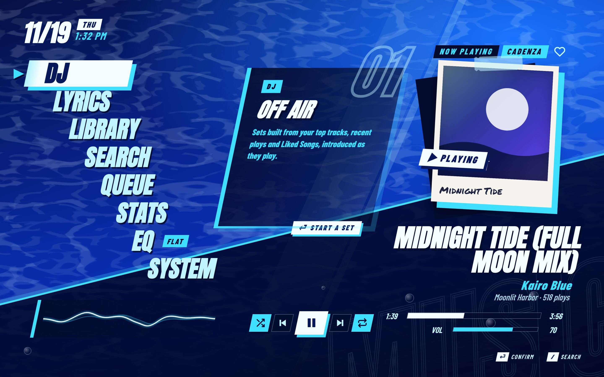
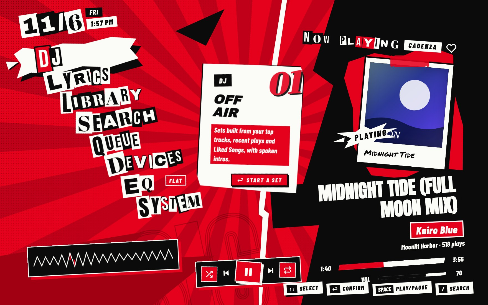

# Cadenza

A keyboard-first Spotify player for macOS with game-menu style themes, a DJ, synced
lyrics, a real equalizer and a full-screen stage mode.

Cadenza is a small native app written in Swift on top of the Mac's built-in WebKit. It controls Spotify
through the official Web API and plays the audio through [librespot](https://github.com/librespot-org/librespot),
which it starts and manages for you.

> Cadenza is unofficial. It isn't made, endorsed or supported by Spotify. You need Spotify Premium and
> your own free Spotify developer app; see [Setup](#setup).



| HEIST · RED | NEON · CITY |
|---|---|
|  |  |
| STUDIO · MINIMAL | Studio library |
|  |  |
| Stage mode | Command palette (⌘K) |
|  |  |

<sub>The screenshots come from the built-in demo mode, so the songs and covers are made up.</sub>

## Features

- Five themes, each with its own layout, animations and sounds: TIDE · BLUE, HEIST · RED,
  NEON · CITY, STUDIO · MINIMAL and CHROMA · COVER, whose colours come from the album cover that's
  playing. There's one more hidden somewhere.
- Album covers can stay as they are or take on the theme's colours (System → Preferences → Album covers).
- A DJ that builds sets from what you've had on repeat, old favourites, forgotten Liked Songs and
  deep cuts by your top artists, and introduces each segment on screen. With Last.fm connected it
  also digs up songs you used to play constantly and then dropped, and what you were playing this
  week a year ago, and it knows how many times you've played things.
- True shuffle. When you shuffle a playlist, album or Liked Songs, Cadenza shuffles it itself using
  secure random numbers, so every order is equally likely and every song plays once before any
  repeats. Spotify's own shuffle favours some songs and spreads artists out. You can turn it off in
  System → Preferences.
- Autoplay and song radio. Play a song from Search (or pick "Song radio" from a song's menu) and
  similar songs keep coming after it. When an album or playlist ends, it carries on the same way.
  You can turn this off in System → Preferences too. Autoplay learns your taste over time: see
  [Your taste](#your-taste) below.
- Synced lyrics from LRCLIB, timed to what you actually hear. Press T to translate them into your
  Mac's language, offline, with Firefox's translator (see [Lyrics translation](#lyrics-translation)). Search → Lyrics finds a song from a line you remember.
- A playlist builder (N in Library, B on a playlist, or ⌘K): your playlist on the left, and on the right
  songs like the ones you've added, a search box and mood filters (chill, energy, happy, moody, focus,
  party, love). Drag songs to order them, spread out artists, shuffle, undo, and save as a new playlist
  or back to the one you opened. What you're building is kept if you leave the page.
- Up Next, Cadenza's own queue: add with Q, reorder with ⌥↑/⌥↓, remove with X, clear with C.
- Listening stats for the week, month, year or all time: top artists and songs, plays, and the hours
  you listen. Import the history Spotify sends you and they cover every play since your account
  began. They can also come from Last.fm, or from what Cadenza itself has played.
- Play counts from Last.fm on every song: in playlists, albums, search, the queue and Now Playing,
  plus how many times you've played an artist on their page.
- Friends: what your Last.fm friends are playing right now, a taste match score, the artists you have
  in common, and a blend of your favourites and theirs (B). Add anyone by username.
- A crossfade like Spotify's (System → Sound & EQ: off, 3, 6, 9 or 12 seconds). The end of each song
  overlaps the start of the next.
- A floating mini player (⇧⌘M) and a sleep timer (⌘K → "sleep").
- `cadenza://` links for the Shortcuts app, Siri, Raycast, Alfred or Terminal.
- A ten-band EQ with presets and a boost with a limiter. Each output device keeps its own EQ.
- Stage mode: a full-screen cover with lyrics and a live visualizer.
- A command palette (⌘K) that reaches everything: every page, playlist, setting, device, theme, EQ
  preset and button, the song that's playing and the one you've selected, plus live Spotify results
  for songs, artists, albums and playlists as you type.
- Playlist tools: remove duplicates, sort, copy, save the queue as a playlist, and play history.
- A menu-bar mini player drawn in your theme's style. Also media keys, Control Center and song
  notifications.
- Discord status, Last.fm stats and automatic updates from GitHub releases.
- Playlist tags (genre, mood, era), from the artists' Spotify genres and Last.fm tags and the songs'
  release years.

## What you need

- macOS 13 (Ventura) or later
- Spotify Premium (Spotify only allows playback control with Premium)
- Apple's Command Line Tools: `xcode-select --install`
- Rust, to build the audio engine (librespot) that goes inside the app: `brew install rust`

## Setup

1. Make a free Spotify developer app. Go to
   [developer.spotify.com/dashboard](https://developer.spotify.com/dashboard), create an app,
   add `http://127.0.0.1:8888` under Redirect URIs, tick Web API, and copy its Client ID.
   Everyone uses their own app, so this project has no shared key.
2. Build and install:
   ```bash
   git clone https://github.com/Chedd4rr/Cadenza.git
   cd Cadenza
   ./build.sh --install
   ```
   This compiles the app, puts Cadenza in /Applications and opens it. Without `--install`, the
   app stays in `build/`. The first build also compiles librespot, which takes a few minutes
   (see [The built-in librespot](#the-built-in-librespot)).
3. Log in. Paste your Client ID, press Log in and approve in the browser. The audio engine
   (librespot) then asks you to sign in once more in the browser. If spotify-qt is signed in on
   your Mac, Cadenza offers to reuse its login instead.
4. Allow media keys. macOS asks for Accessibility permission; turn Cadenza on in
   System Settings → Privacy & Security → Accessibility.

`build.sh` signs the app with a self-made certificate ("Cadenza Local Signing", created once in your
login keychain), so macOS keeps the Accessibility permission across rebuilds.

### Or download a release

Prebuilt copies are on the [Releases](https://github.com/Chedd4rr/Cadenza/releases) page. Unzip one and
drag Cadenza into Applications. Apple hasn't notarized it, so the first time you open it macOS says it
can't check it. Right-click Cadenza and choose Open, then Open again (or run
`xattr -dr com.apple.quarantine /Applications/Cadenza.app`). librespot is already inside; you still
need your own Spotify Client ID (steps 1, 3 and 4 above).

### The built-in librespot

`librespot.sh` (run by `build.sh`) builds librespot from source and puts it inside Cadenza.app, so
there's nothing else to install:

- It's pinned to one commit of librespot's dev branch (7 Nov 2026), which has fixes for changes Spotify
  made in late 2026 that aren't in a release yet. If that commit is ever gone, it builds release 0.8.0.
- On top go the patches in `patches/`, each explained at its top:
  - `librespot-retry-keys.patch`: when Spotify refuses a song's key with its "try again" code
    (`error audio key 0 2`), librespot asks again up to 3 times instead of skipping the song (from
    [pull request #1763](https://github.com/librespot-org/librespot/pull/1763), not merged yet).
  - `librespot-skip-refused.patch`: when it still refuses after that, librespot skips the song straight
    away instead of downloading it anyway, failing to read it and deleting a good cached copy.
  Changing a patch's code makes the next build rebuild librespot.
- It's built for your Mac's chip, with pipe output only (Cadenza plays the sound through its own engine)
  and without debug symbols, which keeps it to roughly 7-10 MB.
- The source is fetched by exact commit (the 0.8.0 fallback too), and `cargo build --locked` uses the
  dependency versions in librespot's `Cargo.lock`, so a build can't silently pick up different code.
- The source and the finished program live in `~/Library/Developer/Cadenza/librespot`, never in this
  repo. Later builds reuse it.
- No Rust installed? The app is built without it and uses a Homebrew librespot
  (`brew install librespot`). Set `CADENZA_SKIP_LIBRESPOT=1` to skip it on purpose.

To use a different librespot, set System → Engine settings → Librespot path. Cadenza uses that first,
then its own copy, then a Homebrew one.

## Keys

| Key | Action |
|---|---|
| ↑ ↓ ← → | Move the selection |
| Return | Choose / play |
| Esc or Delete | Back |
| Space | Play / pause |
| ⌘→ / ⌘← | Next / previous song |
| ⌘↑ / ⌘↓ | Volume |
| ⌘S / ⌘R | Shuffle / repeat |
| ⌘K | Command palette |
| ⌘F or / | Search |
| F or ⌘⇧F | Stage mode |
| ⌘T | Switch theme |
| ⌘, | System settings |
| ⌘/ | Every command and shortcut (also System → Commands) |
| ⌥⌘P | Show or hide Cadenza from any app |
| L / C / M | Like / copy link / song menu |
| Q / A | Queue the song / add it to a playlist |
| P / T | Play a whole playlist / playlist tools |
| N / R / D / X | New, rename, delete playlist / remove a song |
| ⌥↑ / ⌥↓ | Move a song in your playlist |
| [ / ] | EQ presets; in Lyrics, nudge the timing earlier or later |

The mouse and trackpad work too, and the Controls menu in the menu bar has the main commands.

## Pages

| Page | What it does |
|---|---|
| Home | DJ, Lyrics, Library, Search, Queue, Stats, EQ and System, plus the now-playing panel with playback controls. Click the artist or album there to look it up in Search. |
| DJ | Builds a set and introduces each segment on screen |
| Lyrics | Synced lyrics; click a line to jump there |
| Library | Liked Songs and your playlists, with genre · mood · era tags. N starts a new playlist in the builder |
| Build | The playlist builder. Tab switches between your playlist and the suggestions; ⏎ adds, P previews, drag or ⌥↑↓ to move, X removes, ← → picks a mood, R finds more ideas, D spreads artists, H shuffles, U undoes, S saves |
| Playlist / Album / Artist | Play, queue, add, remove, reorder, edit details and cover, save, follow, share |
| Search | Songs, albums, artists and playlists (Tab switches type) |
| Queue / History | Your Up Next, then Spotify's queue; and what you played recently |
| Stats | Top artists and songs, plays, when you listen: your imported Spotify history, Last.fm and Cadenza together, or Last.fm's charts or Cadenza's own log on their own (S switches). I imports Spotify history |
| Your taste | What autoplay has learned about you: artists, songs and styles you love or skip, what you play at different times, what matters most when it picks, and artists you've banned (T in Stats, or ⌘K). X removes something, + / − marks an artist you love or hate, Tab goes to the controls |
| Friends | Your Last.fm friends: what they're playing, taste match, artists in common, blends (F in Stats, or ⌘K) |
| Devices | This Mac's outputs (speakers, AirPods, Bluetooth) and Spotify Connect devices (System → Devices, or ⌘K) |
| EQ | Ten bands (32 Hz to 16 kHz), presets, boost |
| System | Theme, account and the most-used settings at the top; Sound & EQ, Connections, Preferences and Engine settings in groups |

## Discord, Last.fm and updates

For Discord status, make an application at
[discord.com/developers/applications](https://discord.com/developers/applications). Discord shows the
application's name, so call it Cadenza. Copy its Application ID into System → Connections and turn on
Discord status. The Discord app has to be running.

For Last.fm, create an API account at [last.fm/api/account/create](https://www.last.fm/api/account/create),
put the API key and shared secret in System → Connections, then choose Log in. Cadenza reads your
Last.fm history for Stats, play counts, the DJ and Friends.

Cadenza doesn't scrobble by itself. Link Spotify to Last.fm instead (Last.fm settings → Applications →
Spotify scrobbling): Spotify then scrobbles everything you play, on your phone, in the Spotify app and in
Cadenza too, since Spotify records what librespot plays like any other device.

### Your whole Spotify history

Last.fm only knows what was scrobbled, and it won't take years of old plays. Spotify will send you all
of them instead:

1. On [spotify.com/account/privacy](https://www.spotify.com/account/privacy/), tick
   **Extended streaming history** and request it. Spotify emails you a download, which can take a few
   days and up to 30.
2. In Cadenza, open Stats and press **I** (or the **+ IMPORT** button, or ⌘K → "Import Spotify
   listening history"). Pick the .zip Spotify sent, the folder inside it, or the
   `Streaming_History_Audio_….json` files. The shorter "Account data" download
   (`StreamingHistory_music_….json`) works too.

Stats then puts everything together, each play counted once:

1. your imported Spotify history;
2. then everything scrobbled to Last.fm after it ends (if Last.fm is connected), so plays from your
   phone or the Spotify app show up too. Cadenza saves these and only asks Last.fm for new ones, at
   most every 10 minutes. The first time it fetches everything since the import ends, or your whole
   Last.fm history if you haven't imported anything, which can take a minute or two;
3. then anything Cadenza played after it ends that Last.fm doesn't have (say Last.fm was down, or
   Spotify scrobbling isn't linked). Spotify scrobbles Cadenza's plays, so a Cadenza play counts as the
   same play when Last.fm has the same song within 10 minutes.

Press **S** on the Stats page to switch between that (ALL), Last.fm's own charts and Cadenza's own log.
Last.fm doesn't say how long you listened, so a scrobble counts for that song's usual length from your
other plays (or 3.5 minutes) in "hours listened".
The same song scrobbled twice within 90 seconds (an older Cadenza that still scrobbled, plus Spotify)
counts once.

- No play is counted twice. A play is matched by the minute it ended and the song's name and artist,
  so importing the same files again, or a newer download that overlaps an older one, only adds what's
  new. It also works across the two kinds of download.
- A play counts in Stats once you listened for 30 seconds, like on Spotify. Shorter plays are kept too,
  along with how each play started and ended (skipped, finished, picked by you, or interrupted): your
  taste profile learns from them (Stats leaves them out). Importing files you've imported before adds
  these details to the plays already there. Plays under a second are kept only if you skipped them;
  podcasts and audiobooks are left out.
- Only the time, length, song, artist, album, song link and those skip/finish details are kept, in
  `~/Library/Application Support/Cadenza/spotify-history.json` (readable only by you). The rest of
  Spotify's files (IP addresses, countries, devices) is never saved. Nothing is uploaded anywhere.
- ⌘K → "Remove imported Spotify history" deletes it again.

### Your taste

Autoplay keeps a taste profile that grows with you. It learns from:

- what you finish and what you skip, and how fast. Skipping a song autoplay picked counts the most,
  since you didn't choose it; a song autoplay offered and you skipped fast twice is left out for a month;
- playing a song again within a day, choosing a song yourself, liking it, adding it to a playlist or
  to the playlist builder;
- "More like this", "Less like this" and "Never autoplay this artist" in any song's menu (M);
- your imported Spotify history, with its skips, and Last.fm scrobbles after it (with neither, your
  Last.fm top artists and songs). That happens after each import, or on the Taste page with H, and is
  rebuilt from scratch each time, so nothing is counted twice. Your past counts a quarter as much as
  what you do now, so it gives autoplay a head start without outweighing how you listen today.
  Skips in your history count more the sooner they came (a few seconds in counts the most). A song that
  ended because you started something else counts half, and one that ended because you pressed back,
  the app quit or the song failed counts as no verdict at all.

It keeps scores for artists, songs and styles (Last.fm tags, or Spotify genres), and for what you play
on weekday and weekend mornings, afternoons, evenings and nights. Old marks fade, half every 90 days,
so it follows you when your taste changes. Scores are proportional: what share of an artist, song or
style you keep (rather than skip) compared with your usual share. A style you play all the time also gets
skipped a lot, because you skip through it to reach other songs in it, so that counts as normal for you,
not as a dislike. Each score is then scaled by how many plays are behind it (8 plays count half, 40
about 85%), so a couple of plays can't put something at the top or bottom. For artists, breadth counts
too: how many different songs of theirs you keep coming back to. One song played a lot says you like
that song (an artist with one favourite gets a quarter of the credit); many different songs say you like
the artist, even if you skip plenty of their others along the way. Skips count for less than finishes,
since you skip for lots of reasons (getting to another song, not the mood right now), not only dislike.
Time counts as well, for artists and styles. Every calendar month you keep listening to one adds to how
long you've stuck with it (those months fade by half over a year), so an artist you've played for years
and still play outranks one you just found. A burst of plays lately (the last couple of weeks) gives a
boost too, which wears off once you move on. The Taste page marks these "FOR YEARS" and "LATELY".

Artists and styles have separate scores. An artist's base score also gets:

- a share for how many of your own playlists (and Liked Songs) have their songs: three playlists give
  half of it. Cadenza reads your playlists slowly in the background, a little after launch and every six
  hours, and only reads a playlist again when it has changed;
- a small nudge (never a penalty) when they belong to styles you like.

Styles only count tags that are a kind of music: countries, cities, nationalities and the like
("germany", "french", "seen live") are left out. And a style counts for more the more artists you keep
listening to have it: one artist gets a quarter, three get half, ten about three quarters, so one band
you play constantly can't fill Your styles with its own tags.

And a liking that rests on only a few songs counts for less: if you only keep coming back to one to
three of an artist's songs, or your playlists only have one to three of their songs, their score is
scaled down (by up to about a third for each).

Press ⏎ on an artist on the Taste page to see what their score is made of: songs you keep, playlists and
months. Songs and styles you binge count for less: plays bunched
into one week add up slower (30 plays in a week count about like 10), and something you played five or
more times in a week and then left alone for over a month keeps losing weight the longer you stay away.

When autoplay picks the next songs, it weighs how close a match each one is, how you treat the artist
and the style, whether it fits this time of day, whether you love that exact song, whether you've heard
the artist a lot in the last couple of hours, and whether the artist is new to you. It learns how much
each of those matters to you from which of its picks you keep. Every sixth song is a new artist, so it
keeps finding things. The Queue page says why each autoplay song is there.

The Taste page (T in Stats, or ⌘K → "Your taste") shows all of it, and you can correct it:

- You skip lists artists only (styles and songs you skip still count for autoplay, just not here).
- On anything under You love, Your styles or You skip, press X (or ⏎ for options) to take it out of
  the profile. What it learned about it so far stops counting, including from your imported history;
  what you do from now on counts again.
- Press + or − on an artist to mark them as an artist you love or hate (or use A, or a song's menu).
  Your mark overrides what the profile worked out, and an artist you hate is never autoplayed. Marked
  artists are listed at the top; press the same key again (or X) to clear the mark.
- Tab switches to the controls: mark an artist by name, learn from your history, let banned artists back,
  or forget everything. The profile is kept in `~/Library/Application Support/Cadenza/taste.json`, readable
only by you, and never leaves your Mac.

Cadenza checks this repository's releases at launch (at most every 6 hours) and offers to install new
versions. To follow a fork instead, set System → Preferences → GitHub repository (Cadenza asks you to
confirm).

Cadenza keeps your Last.fm secret and session and your Genius token in a file only your account can
read (`~/Library/Application Support/Cadenza/secrets.json`), next to the Spotify login. None of them
are ever sent to the page that draws the interface.

Cadenza only installs an update signed with the same certificate as the copy you're running.
Release builds are signed with the maintainer's certificate. If you built Cadenza yourself, your copy is
signed with your own "Cadenza Local Signing" certificate, so Cadenza opens the release page instead of
installing. Pull and run `./build.sh --install` to update. (This also keeps macOS from asking for the
Accessibility permission again, which happens when the signature changes.)

## Lyrics translation

Press T on the Lyrics page (or ⌘K → "Translate the lyrics"). Cadenza works out which language the lyrics
are in with Google's CLD3 and translates each line into your Mac's language with Firefox's offline
translator. Both run inside Cadenza; the lyrics never leave your Mac.

The first time you translate from (or into) a language, Cadenza downloads its model from Mozilla, the
same one Firefox uses: about 15 to 60 MB per direction, checked against the hash Mozilla publishes. A
language with no direct model goes through English, which needs two. After that it works offline.
System → Preferences → Translation languages shows how much space they take and deletes them.

It covers the languages Firefox translates, as long as the model works with the version of the
translator bundled here (v0.4.5); when a newer model won't load, Cadenza tries an older one. Very short
lyrics can be mistaken for a similar language.

## Shortcuts, Siri and links

Cadenza answers `cadenza://` links, so the Shortcuts app (with Open URLs), Siri (through a shortcut),
Raycast, Alfred or Terminal (`open "cadenza://next"`) can control it:

| Link | Does |
|---|---|
| `cadenza://toggle` · `cadenza://next` · `cadenza://previous` | Play/pause, skip, go back |
| `cadenza://play?q=midnight%20tide` | Search for a song and play it, with song radio after it |
| `cadenza://playlist?name=Gym&shuffle=1` | Play one of your playlists |
| `cadenza://radio` · `cadenza://dj` | Song radio from what's playing · start the DJ |
| `cadenza://like` · `cadenza://upnext` | Like the song · add it to Up Next |
| `cadenza://volume?level=40` (or `up` / `down`) | Volume |
| `cadenza://search?q=…` · `cadenza://go?page=stats` · `cadenza://friends` | Open Search, a page, or Friends |
| `cadenza://sleep?minutes=30` (or `end`, `off`) | Sleep timer |
| `cadenza://mini` · `cadenza://show` · `cadenza://hide` | Floating mini player · show or hide Cadenza |

## Finding a song from its lyrics

Search → Lyrics (Tab to it) looks up a line you remember on [Genius](https://genius.com), then
finds the song on Spotify. It needs a free Genius access token. Go to
[genius.com/api-clients](https://genius.com/api-clients), create an API client (any name and website
will do), press Generate Access Token, and paste the token into System → Connections → Genius token.

## Making a release

1. Bump `CFBundleShortVersionString` in `Resources/Info.plist`.
2. Run `./release.sh`. It builds the app, packs `build/Cadenza-<version>.zip` with `ditto` so the
   signature survives, and offers to publish it as release `v<version>` with the GitHub CLI.
   The zip includes the built-in librespot, so make sure the build log says
   "librespot is inside the app" (that needs Rust). The app and librespot are built for the chip of
   the Mac you build on, so a release made on Apple Silicon runs on Apple Silicon Macs only.
3. Always build releases on the Mac that has your "Cadenza Local Signing" certificate. Copies of Cadenza
   only install updates signed with the same certificate they were signed with, so if you lose it,
   everyone has to download the next version by hand. Back it up from Keychain Access (export it as a
   .p12).

## Themes

Switch with ⌘T or System → Theme. Each theme is a folder in `Resources/web/themes/` with a
stylesheet, a script for its background and animations, and its own click sounds. The sounds are
synthesised, so there are no audio files.

CHROMA · COVER is a psychedelic comic page printed like a risograph poster, in the playing song's
cover colours. The four strongest colours on the cover become four inks: an abstract poster of
overprinted shapes, halftone screens and coloured smoke fills the page, with misregistered second
passes and paper grain, and every song gets its own arrangement that the shapes glide into. On top sit
ink-outlined panels with echo outlines behind whatever is selected, typewriter caption boxes and
speech-balloon toasts. When the song changes, every colour fades over to the new cover's. (The menu-bar player keeps the blue look.)
With System → Preferences → Album covers set to "In the theme's colours", every cover is shown in
shades of the theme's own dark, accent and light colours; your covers aren't changed, only how
Cadenza draws them. To make your own theme, see
[`Resources/web/themes/README.md`](Resources/web/themes/README.md).

## Working on the UI

The interface is plain HTML, CSS and JavaScript in `Resources/web/`. Open `Resources/web/index.html`
in a browser for a demo mode with sample data, and add `?theme=heist` (or `neon`, `min`, `chroma`) to preview a
theme. The menu-bar player is `Resources/web/mini/mini.html`; open it the same way (`?theme=neon`) to
preview it. Run `./build.sh --install` after changes.
In the app, Option-right-click → Inspect Element opens the Web Inspector.

The native code is in `Sources/Cadenza/`:

| File | Does |
|---|---|
| `AppDelegate.swift` | window, menus, shortcuts |
| `Bridge.swift` | messages between the page and native code |
| `SpotifyAuth.swift`, `SpotifyAPI.swift` | login (PKCE) and API calls, with rate-limit handling |
| `Librespot.swift` | starts librespot and reads its events |
| `EQ.swift` | the sound engine: EQ, limiter, fades, crossfade and the spectrum analyser |
| `AudioOutputs.swift` | output devices |
| `MediaKeys.swift`, `StatusBar.swift`, `Notifier.swift` | media keys and Control Center, menu-bar player (drawn by `Resources/web/mini/`), notifications |
| `Discord.swift`, `LastFM.swift`, `Updater.swift` | integrations |
| `History.swift` | Cadenza's own listening history (one of the sources for Stats) |
| `SpotifyHistory.swift` | imports the listening history Spotify sends you without duplicates, and keeps the Last.fm scrobbles made since |
| `Extras.swift` | lyrics from LRCLIB, finding songs on Genius, picking a playlist cover |
| `Migration.swift` | brings over settings and data from when the app was called Chord |
| `FloatingPlayer.swift` | floating mini player |
| `CoverArt.swift` | downloads each album cover once for the menu bar, mini player, Control Center and notifications |
| `TranslationModels.swift` | downloads and checks the translation models, and serves the translator's files to the page |
| `Settings.swift`, `Store.swift` | preferences and small saved data |

`Sources/ObjCSafe/` holds a small Objective-C helper that catches the audio engine's exceptions,
which Swift can't do on its own.

## Troubleshooting

System → Engine settings → Copy diagnostics (or ⌘K → "diagnostics") copies the engine log, recent
playback events and your settings, without passwords or keys, so you can paste them into a bug report.
Your Spotify username and home folder are left out too.

- "No active device": Cadenza restarts librespot by itself when Spotify stops listing it as a speaker
  (this mostly happens after the Mac sleeps or the network drops). If it still doesn't show up, check
  System → Engine settings → Audio engine. If librespot isn't found, this copy was built without
  Rust: run `brew install rust` and build again, or `brew install librespot`, or set its path there.
- Songs get skipped on their own, and the log shows `error audio key 0 2`: Spotify refused to unlock
  that song for librespot. This is a known librespot problem
  ([issue #1649](https://github.com/librespot-org/librespot/issues/1649)) and mostly hits some
  accounts. The built-in librespot asks again a few times before giving up; Cadenza then skips the
  song without a warning, leaves it out of autoplay for 10 minutes and keeps the music going. If almost every
  song is refused, Spotify is refusing your account for now. Skipping less for a while helps.
- Login fails: check the Client ID, and check that `http://127.0.0.1:8888` is a Redirect URI of your
  Spotify app.
- "Spotify says wait": Spotify limits how often an app can ask for things. Cadenza backs off on
  its own, and System → Spotify activity shows what it has been asking for.
- A playlist's songs don't load: Spotify only lets apps read the songs of playlists you own or
  collaborate on. You can still play the ones you follow (press P).

## Credits

- [librespot](https://github.com/librespot-org/librespot) (MIT) plays the audio. A copy ships inside
  the app; its license is in `Cadenza.app/Contents/Resources/licenses/librespot-LICENSE.txt`.
- Lyrics come from [LRCLIB](https://lrclib.net).
- Lyrics translation uses [bergamot-translator](https://github.com/browsermt/bergamot-translator)
  (Mozilla Public License 2.0), the translator inside Firefox, with Mozilla's translation models, and
  [CLD3](https://github.com/google/cld3) (Apache 2.0) through [cld3-asm](https://github.com/kwonoj/cld3-asm)
  (MIT) to tell which language the lyrics are in. Both are in `Resources/web/vendor`, with notices.
- Finding songs by lyrics uses the [Genius API](https://docs.genius.com) with your own token.
- Fonts: Anton, Barlow Condensed, Archivo Black, Abril Fatface, Bebas Neue, Chakra Petch, Rajdhani,
  Share Tech Mono, Inter, Unbounded, Space Grotesk, JetBrains Mono and Silkscreen are under the SIL
  Open Font License. Permanent Marker is under the Apache License 2.0. The licence files sit next to
  the fonts.

Found a security problem? See [SECURITY.md](SECURITY.md).

Spotify is a trademark of Spotify AB. This project isn't affiliated with Spotify.

## License

[MIT](LICENSE) © 2026 Chedd4rr
